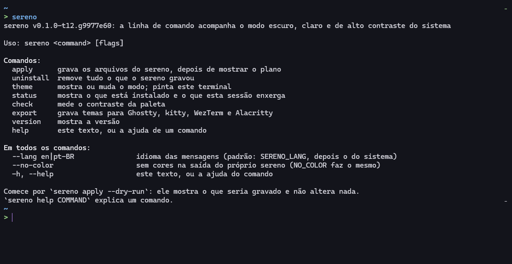
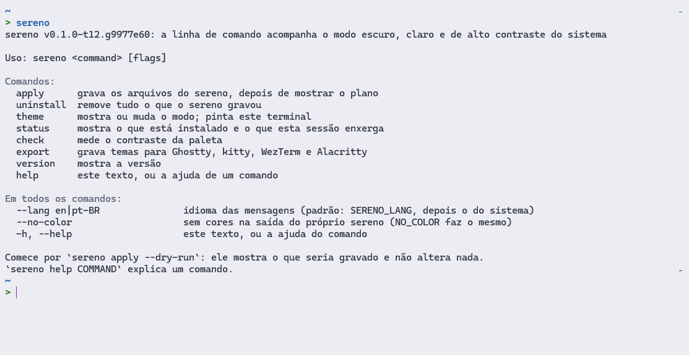
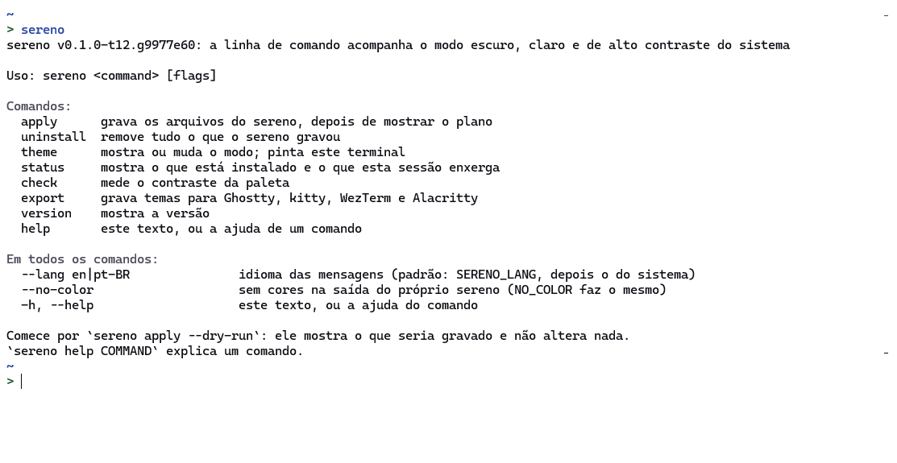

# Serena Terminal

Serena Terminal is not a terminal emulator, and it is not related to the Oraios "Serena" coding tool.

It is `sereno`, one command without dependencies that makes the terminal you already use follow the system's dark, light and high-contrast setting, with the six colour schemes of [Serena Theme](https://github.com/joaooliveira10/serena-theme) and a measured contrast for every colour. On Windows it adds a "Serena" profile and six colour schemes to Windows Terminal and sets up PowerShell 5.1 and 7; on macOS and Linux it sets up bash and zsh and writes theme files for Ghostty, kitty, WezTerm and Alacritty. It prints a plan before it writes anything, keeps a record of every file it writes, and `sereno uninstall` removes exactly those.

Leia em português: [README.pt-BR.md](README.pt-BR.md).



*Serena Dark Vivid, chosen in Windows Terminal's settings, as Windows Terminal 1.24.12741.0 draws it on the maintainer's machine, 2026-10-14.*



*Serena Light or Serena Light Vivid (the two have the same background and text colour), chosen in Windows Terminal's settings, as Windows Terminal 1.24.12741.0 draws it on the maintainer's machine, 2026-10-14.*



*Serena High Contrast Light, chosen in Windows Terminal's settings, as Windows Terminal 1.24.12741.0 draws it on the maintainer's machine, 2026-10-14.*

The schemes were chosen there for the Serena profile, so these pictures show the schemes, not sereno following Windows. The tab holds the Serena prompt and what `sereno` prints without a command, in Portuguese; the pictures come from the acceptance test described under Status.

## Status

<!-- sereno:status unreleased -->
**Version 0.1 is not released yet.** There is no tag `v0.1.0` and no release of it. Tags of the form `v0.1.0-rc.N` are release candidates: they exist to try the release process itself, and what is built from one is not version 0.1. The release archives and the install scripts described below can so far come from a release candidate only, where one is published on the releases page as a pre-release; otherwise the program is built from a checkout of this repository.

What has been checked so far, and what has not:

- **Run and passing** on Windows 11 with Windows PowerShell 5.1 and Git Bash: the Go tests, the behaviour tests of the PowerShell and bash session files, a run of the built program in a temporary home folder (apply, status, theme, check, export, hook lines, uninstall, with the whole folder compared before and after), and the tests of the install scripts.
- **Run and passing** on Linux (Ubuntu under WSL): the Go tests, the bash tests, and the tests of the install script under `dash`.
- **Run and passing in CI only** (GitHub-hosted runners: Windows Server 2025, macOS 26 on arm64, Ubuntu 24.04; this is said of run 38473863799 of the CI workflow, on 2026-10-14, which ran commit 9977e60, the commit of the acceptance test, and passed in all nine jobs): the same tests, and with them everything that is not on the maintainer's machine: PowerShell 7 (7.6.6 on Windows and Linux, 7.6.5 on macOS, with PSReadLine 2.4.5), zsh 5.9 on macOS and Linux, and bash 3.2.57 on macOS. That includes the comparison of the three prediction colours of PSReadLine in `test/shell/run.ps1`, which needs PSReadLine 2.1 or newer and so cannot run on that machine: that run was the first of it as it stands, under PowerShell 7.6.6 on Windows, and it passed there. What had changed since the runs of 2026-10-08 has run in CI too, in that run and in run 38457983362 of 2026-10-13 before it: the hook line of PowerShell, what `init.ps1` does in a console window of Windows whose background is not black and in a session without a console, when PowerShell is asked for its profile and that it is asked without the variable `PSExecutionPolicyPreference`, the starting folder of the Serena profile, when `sereno status` warns about the theme of Windows Terminal, and some sentences of apply, status and uninstall. Like every run of CI they were of temporary home folders on hosted runners: they say nothing of a real user profile. No person has seen any of these on a screen.
- **Committed after that commit:** sentences of these documents, the three pictures in `docs/images`, and one sentence of the program with the tests that hold it: what `sereno apply` says on Windows about opening a new window of Windows Terminal, in both languages. That sentence and its tests have run on the maintainer's machine only (Windows 11, Windows PowerShell 5.1), and no apply outside a test has printed it.
- **Seen on a screen first:** on 2026-10-08 the maintainer ran `sereno theme --paint light` in an open tab of Windows Terminal 1.24 on his machine, and the tab turned light. Sending the palette to an open tab is what following the system rests on.
- **Applied to a real user profile** on 2026-10-14, in the acceptance test on the maintainer's machine (Windows 11, Windows Terminal 1.24.12741.0, Windows PowerShell 5.1), with the program built from commit 9977e60. Checked from files, hashes and his screenshots: what `sereno apply` wrote, byte for byte; a Serena tab that opened on Serena Dark in his home folder; four of the six colour schemes as Windows Terminal draws them; the hook line in a PowerShell profile that sereno created; `sereno status`; and that after `sereno uninstall` and `install.ps1 -Uninstall` nothing of what they wrote was left outside the two files of Windows Terminal. The record of that test is in [docs/spec-0.1.md](docs/spec-0.1.md), under "What the owner saw on a screen".
- **Reported by the maintainer, with no picture and no values recorded:** that the open tab followed Windows to light, and through contrast themes (which themes, and what each showed, was not written down); that the six schemes are in Windows Terminal's settings; that VS Code's terminal, a tab of the stock Windows PowerShell profile and Windows PowerShell started from the Start menu were fine with the hook line; and what Windows Terminal showed after the uninstall.
- **Not done yet:** the four exported theme formats were not checked in their emulators.

The pictures at the top of this page, in `docs/images`, are three of the screenshots of that acceptance test, cropped to the tab.

## What it writes, and where

`sereno apply --dry-run` prints the plan and changes nothing. This is its output on a Windows 11 machine that has Windows Terminal, from a real run in a test home folder (that folder is shown as the home of a user named `user`; `dev` is the version of a program that does not come from a release archive):

```text
sereno dev: plan
  mkdir   C:\Users\user\AppData\Local\sereno
  mkdir   C:\Users\user\AppData\Local\sereno\shell
  mkdir   C:\Users\user\AppData\Local\Microsoft\Windows Terminal\Fragments\SerenaTerminal
  create  C:\Users\user\AppData\Local\sereno\manifest.json
  create  C:\Users\user\AppData\Local\sereno\shell\init.ps1
  create  C:\Users\user\AppData\Local\sereno\shell\init.bash
  create  C:\Users\user\AppData\Local\sereno\shell\init.zsh
  create  C:\Users\user\AppData\Local\sereno\mode
  create  C:\Users\user\AppData\Local\Microsoft\Windows Terminal\Fragments\SerenaTerminal\sereno.json
Total: 3 mkdir, 6 create.
Windows Terminal adds a short entry for the Serena profile to its own settings.json the first time it sees it, as it does for every fragment profile. sereno does not write that file. Use --no-profile to install only the colour schemes.
This was a dry run. Run the same command without --dry-run to carry it out.
Nothing was changed.
```

On Linux, with an empty home folder (shown as `/home/user`):

```text
sereno dev: plan
  mkdir   /home/user/.local
  mkdir   /home/user/.local/share
  mkdir   /home/user/.local/share/sereno
  mkdir   /home/user/.local/share/sereno/shell
  create  /home/user/.local/share/sereno/manifest.json
  create  /home/user/.local/share/sereno/shell/init.ps1
  create  /home/user/.local/share/sereno/shell/init.bash
  create  /home/user/.local/share/sereno/shell/init.zsh
  create  /home/user/.local/share/sereno/mode
Total: 4 mkdir, 5 create.
This was a dry run. Run the same command without --dry-run to carry it out.
Nothing was changed.
```

What those files are:

| File | What it is |
| :--- | :--- |
| `sereno\shell\init.ps1`, `init.bash`, `init.zsh` | The session setup for PowerShell, bash and zsh: prompt, colours, and the check that follows the system. The same bytes for every user; they print nothing and start no program. |
| `sereno\mode` | Five lines with the settings: `mode`, `flavor`, `inband`, `keys`, `prompt`. |
| `sereno\manifest.json` | The record of every file and folder sereno wrote, with the SHA-256 of each file. `uninstall` goes by it. |
| `Fragments\SerenaTerminal\sereno.json` | One fragment for Windows Terminal: the "Serena" profile and the six colour schemes. Written only on Windows, and only when Windows Terminal is found. |

sereno's own folder is `%LOCALAPPDATA%\sereno` on Windows and `~/.local/share/sereno` on macOS and Linux (`$XDG_DATA_HOME/sereno` when that variable is set). The variable `SERENO_HOME` moves it. Later commands add to that folder: `sereno export` writes `themes`, a hook line in a start-up file that was already there adds `backups`, and while a command writes there is an empty file `lock`.

No file of yours is edited by default. Only when you ask with `--hook` does sereno add one line to the start-up file of a shell. A file that is already there is first copied to `backups`, and the plan shows `append`, as here; where there is none yet, sereno creates the file with that one line (the plan shows `create`), and there is nothing to copy:

```text
  append  C:\Users\user\Documents\WindowsPowerShell\Microsoft.PowerShell_profile.ps1
          + if ($ExecutionContext.SessionState.LanguageMode -eq 'FullLanguage' -and [System.IO.File]::Exists("$env:LOCALAPPDATA\sereno\shell\init.ps1")) { . "$env:LOCALAPPDATA\sereno\shell\init.ps1" } # sereno:hook
  append  C:\Users\user\.bashrc
          + [ -r "$LOCALAPPDATA/sereno/shell/init.bash" ] && . "$LOCALAPPDATA/sereno/shell/init.bash" # sereno:hook
```

sereno never writes Windows Terminal's `settings.json` or `state.json`, the registry, `PATH`, an execution policy, a login shell, or the configuration folder of any emulator. It installs no tool, font, shell or emulator. Windows Terminal itself does write: the first time it sees the Serena profile it adds a short entry for it to its own `settings.json`, as the plan says. [docs/uninstall.md](docs/uninstall.md) describes what that means when you remove sereno.

## Install

Placing the program changes nothing on the machine: sereno writes only when you run `sereno apply`.

### From source

This works today. It needs Go 1.24 or newer. In a checkout of this repository:

```sh
go build ./cmd/sereno
```

That leaves `sereno` (`sereno.exe` on Windows) in the current folder. Run it by its path, or move it to a folder on your `PATH`.

### With `go install`

Available once the tag `v0.1.0` exists:

```sh
go install github.com/joaooliveira10/serena-terminal/cmd/sereno@v0.1.0
```

A program installed this way reports its version as `dev`: the tag is stamped only into the programs of the release archives.

### From a release archive

Available once the first release exists. A release has one archive per system, named `sereno_<version>_<os>_<arch>.zip` for Windows and `.tar.gz` for macOS (`darwin`) and Linux, for `amd64` and `arm64`. Each holds the program, `LICENSE` and `README.md`. `checksums.txt` lists the SHA-256 of the six archives: compare it with what `Get-FileHash` (Windows), `sha256sum` (Linux) or `shasum -a 256` (macOS) prints for your download. The release also carries an attestation of where the files were built, which the GitHub command line checks:

```sh
gh attestation verify sereno_v0.1.0_linux_amd64.tar.gz --repo joaooliveira10/serena-terminal
```

The programs are not signed. How Windows SmartScreen, antivirus programs or macOS Gatekeeper treat them has not been tested.

### With the install script of a release

Available once the first release exists. Each release has its own `install.ps1` (Windows) and `install.sh` (macOS, Linux). A script downloads the archive of its own release for your processor, compares the SHA-256 with the value written into the script when the release was built, stops if they differ, and places only the program in the `bin` folder of sereno's own folder. It does not change `PATH` or any other setting and does not start the program. Download the script, read it, then run it:

```powershell
Invoke-WebRequest -UseBasicParsing -Uri https://github.com/joaooliveira10/serena-terminal/releases/download/v0.1.0/install.ps1 -OutFile install.ps1
powershell -NoProfile -ExecutionPolicy Bypass -File install.ps1
```

```sh
curl --fail --location --output install.sh https://github.com/joaooliveira10/serena-terminal/releases/download/v0.1.0/install.sh
sh install.sh
```

The script prints the full path of the program and the next command. Because `PATH` is not changed, you call the program by that path until you have applied it: after `sereno apply`, a session that loads sereno's files has a `sereno` command of its own. `install.ps1 -Uninstall` and `sh install.sh --uninstall` remove the program again (run `sereno uninstall` first). On a machine without a network, download the archive elsewhere, put it in a folder and name that folder in the variable `SERENO_INSTALL_FROM`: the script then takes the archive from there, and compares the checksum all the same. The download step of the scripts has not been run against a real release yet, because there is none; everything else in them is tested against a local folder.

## Commands

Start with `sereno apply --dry-run`. Every example below is the output of a real run in a test home folder. `sereno help` lists the commands and `sereno help COMMAND` explains one.

For every command: `--lang en|pt-BR` chooses the language of the messages (otherwise the variable `SERENO_LANG`, then the language of the system), `--no-color` and the variable `NO_COLOR` switch off the colours of sereno's own output, and `-h` or `--help` prints the help.

| Exit code | Meaning |
| :--- | :--- |
| 0 | Done, also when there was nothing to do. |
| 1 | Something failed while running; for `check`, a colour is under its floor. Also: another sereno was writing the same folder, and this one made way. |
| 2 | The command line was not understood. |
| 3 | Refused before anything was written, with the reason and the way out. |
| 4 | Finished, but something was left as it is: a file you edited after sereno wrote it. |

### apply

Writes the files of the plan, and ends by saying what comes next. On Windows with Windows Terminal: "Open a new Windows Terminal window, also one of a Windows Terminal that is already running, and choose Serena in its new-tab menu. If Serena is not listed there, or does not show what this apply changed, close every Windows Terminal window and open Windows Terminal again." On the maintainer's machine, in the acceptance test of 2026-10-14, a new window of a Windows Terminal that was running during the apply listed Serena, by his report. The source code of version 1.24.12741.0 had led to expect the opposite, which is why the advice to close every window stays. On macOS and Linux: "Nothing loads these files yet. To use them, let sereno add one line to your shell's start-up file: `sereno apply --hook bash` (or zsh, pwsh)."

The command can be run again at any time; a second run finds everything as wanted:

```sh
sereno apply
```

```text
sereno dev: plan
  keep    C:\Users\user\AppData\Local\sereno\manifest.json (already as wanted)
  keep    C:\Users\user\AppData\Local\sereno\shell\init.ps1 (already as wanted)
  keep    C:\Users\user\AppData\Local\sereno\shell\init.bash (already as wanted)
  keep    C:\Users\user\AppData\Local\sereno\shell\init.zsh (already as wanted)
  keep    C:\Users\user\AppData\Local\sereno\mode (already as wanted)
  keep    C:\Users\user\AppData\Local\Microsoft\Windows Terminal\Fragments\SerenaTerminal\sereno.json (already as wanted)
Total: 6 keep.
Nothing to do: no file was written.
```

| Flag | What it does |
| :--- | :--- |
| `--dry-run` | Print the plan and change nothing. |
| `--hook LIST` | Also add one line to the start-up file of these shells, comma-separated: `powershell`, `pwsh`, `bash`, `zsh`. This is what brings sereno to VS Code's terminal and to profiles other than "Serena". |
| `--shell auto\|powershell\|pwsh` | The PowerShell the Serena profile starts. `auto` takes PowerShell 7 when it is installed, otherwise Windows PowerShell 5.1. |
| `--no-profile` | Only the six colour schemes, no Serena profile. |
| `--keys profile\|always\|off` | Where the PSReadLine comfort keys apply: in the Serena profile, in every session, or never. |
| `--prompt on\|off` | The Serena prompt: path, branch, result of the last command. |

Options you leave out keep the value of the previous apply. That includes `--no-profile` (to get the profile back: `sereno uninstall`, then `sereno apply`) and hook lines: a hook that was asked for once is checked by every later apply, in the file where it was put (PowerShell is asked again only when you name it in `--hook` again, or when that file is gone), and `sereno uninstall --hook LIST` withdraws it.

### uninstall

The undo of apply. With `--dry-run` it prints what it would do:

```sh
sereno uninstall --dry-run
```

```text
sereno dev: plan
  remove  C:\Users\user\AppData\Local\Microsoft\Windows Terminal\Fragments\SerenaTerminal\sereno.json
  remove  C:\Users\user\AppData\Local\sereno\shell\init.bash
  remove  C:\Users\user\AppData\Local\sereno\shell\init.ps1
  remove  C:\Users\user\AppData\Local\sereno\shell\init.zsh
  remove  C:\Users\user\AppData\Local\sereno\mode
  remove  C:\Users\user\AppData\Local\sereno\manifest.json
  rmdir   C:\Users\user\AppData\Local\Microsoft\Windows Terminal\Fragments\SerenaTerminal
  rmdir   C:\Users\user\AppData\Local\sereno\shell
  rmdir   C:\Users\user\AppData\Local\sereno
Total: 6 remove, 3 rmdir.
The sereno program itself stays where it is: C:\Users\user\go\bin\sereno.exe. Delete that file to remove it.
This was a dry run. Run the same command without --dry-run to carry it out.
Nothing was changed.
```

`--hook LIST` takes only the hook line out of the files of the named shells and leaves everything else.

### theme

Without arguments it shows the settings, what the system reports and the variant that follows. With a mode (`auto`, `dark`, `light`, `hc`, `hc-light`), `--flavor soft|vivid` or `--inband profile|always|off` it changes the setting for all sessions:

```sh
sereno theme light --flavor vivid
```

```text
  replace C:\Users\user\AppData\Local\sereno\mode
  replace C:\Users\user\AppData\Local\Microsoft\Windows Terminal\Fragments\SerenaTerminal\sereno.json
Sessions that follow the system read the new setting at their next prompt; all others when they start.
mode                light
flavor              vivid
inband              profile
keys                profile
prompt              on
system theme        dark, no contrast theme
variant             light-vivid (Serena Light Vivid)
palette route       emulator: the emulator's own colour scheme decides
```

`--show` also prints the sixteen colour slots, a sample of every role and the measured contrast. `--paint VARIANT` paints the terminal you are in with one of `dark`, `dark-vivid`, `light`, `light-vivid`, `hc`, `hc-light`, and `--reset` hands the terminal its own colours back; both write nothing to disk and work without an apply, so `sereno theme --paint light` is a way to try a palette with nothing installed. Painting is refused where it cannot work: when the output is not a terminal, in VS Code's terminal, and inside tmux or screen.

### status

Reads and reports; it writes nothing and starts nothing. The warnings say what may surprise you and what to do about it:

```sh
sereno status
```

```text
version             sereno dev (windows/amd64)
folder              C:\Users\user\AppData\Local\sereno
applied             yes
language            en
mode                auto
flavor              soft
inband              profile
keys                profile
prompt              on
system theme        dark, no contrast theme
variant             dark (Serena Dark)
palette route       emulator: the emulator's own colour scheme decides
session             other terminal (not Windows Terminal, not VS Code); started from the Serena profile: no
Windows Terminal    detected; sereno's fragment is installed, with the Serena profile
                    settings: C:\Users\user\AppData\Local\Packages\Microsoft.WindowsTerminal_8wekyb3d8bbwe\LocalState\settings.json
                    theme: not set (Windows Terminal then uses dark)
                    its own entry for the Serena profile: no; has seen the profile: no
hook lines          none
owned files         5, of which 0 edited and 0 missing
PowerShell 7        not on PATH

warnings
  wt.theme-not-system
      Windows Terminal's own theme does not follow Windows (it is dark, its default), so the dark/light scheme pair of the Serena profile does not follow either. sereno's in-band route does, at each prompt. To make the pair follow too, choose "Use Windows theme" under Appearance in Windows Terminal's settings.
  pwsh.absent
      PowerShell 7 (pwsh) is not on PATH. Nothing is missing: Windows PowerShell 5.1 is fully supported. If you want PowerShell 7, this installs it, and sereno never runs it for you: winget install -e --id Microsoft.PowerShell --source winget
```

`--json` prints the same report as JSON, with keys that are not translated.

### check

Measures every colour of the six variants against its background (WCAG contrast ratio) and ends with exit code 1 when one is under its floor: 4.5 for dark and light, 7.0 for high contrast.

```sh
sereno check
```

```text
dark         minimum 4.52:1 at slot 8, floor 4.5: pass
dark-vivid   minimum 4.52:1 at slot 8, floor 4.5: pass
light        minimum 4.51:1 at slot 11, floor 4.5: pass
light-vivid  minimum 4.51:1 at slot 11, floor 4.5: pass
hc           minimum 7.82:1 at slot 1, floor 7.0: pass
hc-light     minimum 7.28:1 at slot 15, floor 7.0: pass
Every value is at or above its floor.
```

`--json` gives the measurements as JSON and `--markdown` the table that is committed as [docs/contrast.md](docs/contrast.md).

### export

Writes six theme files per emulator and prints where to copy them and the line that switches them on. Nothing is written into an emulator's own folders.

```sh
sereno export --target kitty
```

```text
sereno dev: plan
  mkdir   C:\Users\user\AppData\Local\sereno\themes
  mkdir   C:\Users\user\AppData\Local\sereno\themes\kitty
  replace C:\Users\user\AppData\Local\sereno\manifest.json
  create  C:\Users\user\AppData\Local\sereno\themes\kitty\Serena Dark.conf
  create  C:\Users\user\AppData\Local\sereno\themes\kitty\Serena Dark Vivid.conf
  create  C:\Users\user\AppData\Local\sereno\themes\kitty\Serena Light.conf
  create  C:\Users\user\AppData\Local\sereno\themes\kitty\Serena Light Vivid.conf
  create  C:\Users\user\AppData\Local\sereno\themes\kitty\Serena High Contrast.conf
  create  C:\Users\user\AppData\Local\sereno\themes\kitty\Serena High Contrast Light.conf
Total: 2 mkdir, 6 create, 1 replace.
Done.

kitty: copy C:\Users\user\AppData\Local\sereno\themes\kitty\Serena Dark.conf as dark-theme.auto.conf and C:\Users\user\AppData\Local\sereno\themes\kitty\Serena Light.conf as light-theme.auto.conf into kitty's configuration folder; from then on it switches by itself.
These four formats are generated from the palette and were not checked on screen in the emulators.
The files belong to sereno's folder: `sereno uninstall` removes them.
```

`--target all|ghostty|kitty|wezterm|alacritty` chooses the emulator (the default is all four). `--to DIR` writes into a folder you name instead of sereno's folder; sereno then keeps no record of the files, and the command works without an apply.

### version

```sh
sereno version
```

```text
sereno dev (windows/amd64)
```

A program from a release archive prints its tag in the place of `dev`.

### help

```sh
sereno help theme
```

```text
Usage: sereno theme [auto|dark|light|hc|hc-light] [--flavor soft|vivid] [--inband profile|always|off] [--show] [--paint VARIANT] [--reset]

Without arguments, shows the settings, what the system reports and the variant that follows from both. A mode, --flavor or --inband changes the setting for all sessions. --paint and --reset only write to this terminal and need no apply.

  auto|dark|light|hc|hc-light   auto follows the system; the others fix one appearance (hc is high contrast)
  --flavor soft|vivid           softer or more vivid colours for dark and light
  --inband profile|always|off   where sereno repaints the terminal at the prompt: in the Serena profile, in every session Windows Terminal started itself, or never
  --show                        also print the 16 slots, a sample of every role and the measured contrast
  --paint VARIANT               paint this terminal now: dark, dark-vivid, light, light-vivid, hc or hc-light
  --reset                       hand this terminal its own colours back
```

## How following the system works, and its limits

On Windows, sereno reads three values of the current user's registry, and only reads them: whether applications use the light theme, whether a contrast theme is on, and the window colour of that contrast theme (which tells a light contrast theme from a dark one). With `mode=auto` they select one of the six variants. A session started from the Serena profile checks them before every prompt, inside the shell and without starting a program, and when the variant is not the one it painted last it sends the sixteen colours, the foreground, the background, the cursor and the selection colour to Windows Terminal. So after you switch Windows between light and dark, the open tab changes at its next prompt: press Enter. There is no background process, and nothing changes while the shell sits idle.

The limits, stated plainly. What sereno does is taken from its code and its tests. Of what Windows Terminal does with it on screen, two things have been seen on the maintainer's machine: an open tab repainted by `sereno theme --paint light`, and a Serena tab that opened on Serena Dark (see Status). That an open tab follows Windows to light, and through contrast themes, is his report from the acceptance test, without a picture. The rest is marked as expected where it matters:

- **The first frame.** A new Serena tab opens with the colour scheme Windows Terminal chooses and is repainted at its first prompt. Windows Terminal's own theme setting is "dark" unless you changed it, so with Windows in light mode a new tab is expected to start dark for a moment. On the one machine this was measured on (Windows PowerShell 5.1), sereno needs about 70 ms to load and about 60 ms more for its first prompt, on top of the start of PowerShell itself.
- **Windows Terminal's own theme setting.** The Serena profile also names a dark and a light scheme as a pair. Windows Terminal switches that pair only when its own setting, under Appearance, is "Use Windows theme"; it is then expected to choose the right scheme for the first frame as well. sereno does not change that setting for you; `sereno status` tells you when it is not set (`wt.theme-not-system`).
- **Only a change is painted.** A session sends the colours when the variant is not the one it sent last. If Windows Terminal puts an open tab back on the profile's scheme by itself (it is expected to do that when its settings are reloaded), the tab stays that way until the system setting changes again, or until you run `sereno theme` in that tab, which sends the colours once more.
- **Other Windows Terminal profiles.** Only sessions started from the Serena profile are repainted. A session of another profile that loads sereno's files through a hook line shows sereno's prompt and line-editor colours in the colour scheme of its own profile, which sereno has not measured ([docs/support-matrix.md](docs/support-matrix.md) has the figures computed for the scheme Windows Terminal ships). The maintainer reported such a tab, of the stock Windows PowerShell profile with a hook line, fine in the acceptance test; its colours were not recorded. `sereno theme --inband always` extends the repainting to every session that Windows Terminal started itself and that loads sereno's files through a hook line, and `--inband off` switches it off.
- **Windows Terminal as the default terminal.** sereno knows a Windows Terminal session by the variable `WT_SESSION`, which Windows Terminal sets for the sessions it starts itself. A PowerShell that Windows opens in Windows Terminal on its own (from the Start menu, the Run box or a shortcut, when Windows Terminal is the default terminal application) is expected not to carry it. sereno then takes the session for one outside Windows Terminal: it is not repainted, with `--inband always` either, its prompt has no marks, and the last point of this list decides about its colours. This is expected from the rule and from an open report against Windows Terminal. In the acceptance test the maintainer started Windows PowerShell from the Start menu, with a hook line, and reported it fine; whether it opened in a tab of Windows Terminal, and whether it carried `WT_SESSION`, was not recorded.
- **VS Code's terminal.** sereno never repaints there: the editor's colour theme owns the palette. With a hook line you get the prompt and the colours of the line editor, and the colours themselves come from the theme you chose in VS Code. The maintainer reported it fine with a hook line in the acceptance test; what it showed was not recorded.
- **macOS and Linux.** Version 0.1 does not detect the system's appearance there. `mode=auto` counts as dark, and nothing is repainted. The supported route is the light/dark pair of your emulator, with the theme files from `sereno export`.
- **tmux and screen** sit between sereno and the terminal: `--paint` and `--reset` are refused there.
- **Windows without Windows Terminal** (the classic console window, or another emulator) gets the prompt and the line-editor colours through a hook line, and no palette: the colours are then those of that console or emulator. sereno does not know what the window is. It goes by what the session carries: no `WT_SESSION`, not the terminal of VS Code, and a console that names a background other than black. Where all three hold, sereno writes none of its colours: the prompt is plain text, the line editor keeps the colours it has, and so do the styles of PowerShell 7. The window Windows PowerShell opens by itself is such a console: its background is the colour sereno would use for keywords and the branch name. No one has looked at this on a screen knowing it was such a console: the Windows PowerShell the maintainer started from the Start menu in the acceptance test may have been one, and what it showed was not recorded.

[docs/how-it-works.md](docs/how-it-works.md) explains the three ways the palette reaches the screen, the settings file, and what the check before each prompt costs.

## Support

Tier 1 means: the maintainer has it on his machine and it is tested there. Tier 2 means: generated and tested by programs, not looked at on a screen by the maintainer.

| | State today |
| :--- | :--- |
| Windows 11, Windows Terminal, Windows PowerShell 5.1 | Tier 1. Automated tests pass on the maintainer's machine, and the acceptance test with his real profile was run there on 2026-10-14; Status says what it checked and what is only his report. |
| Windows 11, PowerShell 7 | Tier 1 by design, the same session file. Automated tests pass in CI under PowerShell 7.6.6; it is not installed on the maintainer's machine, so nothing was run or seen there. |
| Git Bash on Windows | Tier 2. Tested. |
| bash on Linux | Tier 2. Tested on Ubuntu under WSL and in CI. |
| bash 3.2 and zsh on macOS, zsh on Linux | Tier 2. Tested in CI only (bash 3.2.57 and zsh 5.9 on macOS, zsh 5.9 on Ubuntu). |
| Theme files for Ghostty, kitty, WezTerm, Alacritty | Tier 2. Generated and checked against the grammar of each format; not checked in the emulators. |

[docs/support-matrix.md](docs/support-matrix.md) has the details, including the known limits of each shell.

## Uninstall, and what remains

`sereno uninstall` takes the hook lines it added out of the files it added them to, deletes every file it wrote that is still as it wrote it, and removes the folders it created. A file you edited afterwards is left where it is and reported (exit code 4). What it does not remove, and says so when it applies:

- the entry Windows Terminal itself added for the Serena profile to its `settings.json`, and the profile's identifier in its `state.json`. sereno does not write those files. Leave the entry: once Windows Terminal has been closed and opened again, it is expected to leave Serena out of its new-tab menu and to go on listing it in its settings, as a profile that is no longer detected (read from the source code of version 1.24; on 2026-10-14 the maintainer reported just that from his machine, after an uninstall and a restart of Windows Terminal);
- the sereno program;
- the `bin` folder inside sereno's folder, when the install script placed the program there;
- the backup of a start-up file that you changed after the hook line was added.

One thing it neither removes nor mentions: a Serena colour scheme that you chose yourself for a profile in Windows Terminal's settings. Once the schemes are gone, Windows Terminal reports that profile's `colorScheme` as invalid when it starts, as the maintainer reported from his machine after the acceptance test. By its source code it has then put the profile on its default colours by itself ("Defaulting that profile to the default colors", says its English text): that is not left for you to do. The name stays in its `settings.json`, though, and the report is expected at every start until the name is out of that file. By the same source, two things take it out: deleting the profile's `"colorScheme"` line in `settings.json` (Open JSON file, in Windows Terminal's settings), or pressing Save in those settings, which writes the file again without the name. Neither was tried. Applying sereno again brings the schemes back. On the Serena entry, do not use the Delete button: a later reinstall would stay hidden.

It looks for a hook line in the file the line was recorded in, and nowhere else. A start-up file that has moved since keeps sereno's line: uninstall says that no file is in the recorded place, and does not look for the one that moved. One uninstall leaves the line without saying so. `sereno apply` refuses a profile that has moved and names `sereno uninstall --hook powershell`; when the hook is asked for again after that (`sereno apply --hook powershell`), sereno finds its line in the moved file and takes it for yours, and a later uninstall leaves it and says nothing. The move this is expected from is the one of a Documents folder into OneDrive, with the PowerShell profile in it.

[docs/uninstall.md](docs/uninstall.md) lists every case.

## Privacy

sereno has no network code: it opens no connection, sends no telemetry, has no account and does not look for updates. A test fails if the program links Go's network packages. The session files it generates start no program and open no connection either. [docs/privacy.md](docs/privacy.md) says what it reads on your machine.

## Relation to Serena Theme

[Serena Theme](https://github.com/joaooliveira10/serena-theme) is a colour theme for VS Code by the same author. Serena Terminal takes its palette from it: `internal/palette/serena.json` is generated from the six theme files of Serena Theme v1.1.0 and is the only source file here that holds colour values. The two are separate programs; neither needs the other. In VS Code's own terminal the palette belongs to the theme, which is why sereno does not repaint there.

## Licence

MIT, the same as Serena Theme. See [LICENSE](LICENSE). Security reports: [SECURITY.md](SECURITY.md). Changes: [CHANGELOG.md](CHANGELOG.md).
